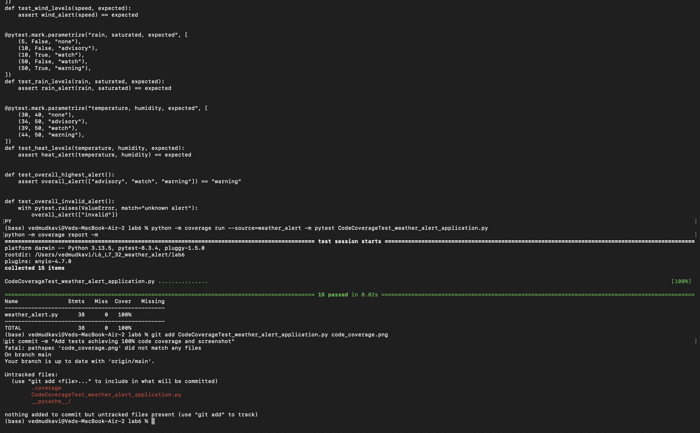
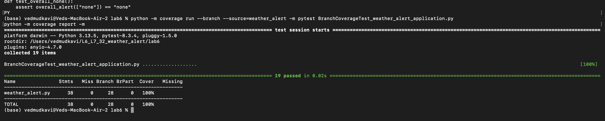

# Lab 06: Code and Branch Coverage Analysis

**Student:** Ved Mudkavi (PES1UG24CS522)  
**Problem 32:** Weather Alert Classifier

Application source: [assigned starter repository](https://github.com/SETAPESU26/L6_L7_32_weather_alert/tree/main/lab6).
The application is unchanged. Tests exercise wind, rain, heat, and overall alert classification.

## Code coverage

The original two starter tests covered 32% of the application statements.
The expanded suite has 15 passing tests and covers all 38 statements (100% line coverage, zero missed statements).
It checks all alert levels, saturated and unsaturated soil, humidity adjustment, overall severity, and invalid alerts.

```bash
cd Lab-6
python -m pip install coverage pytest
python -m coverage run --source=weather_alert -m pytest CodeCoverageTest_weather_alert_application.py
python -m coverage report -m
```



Figure 1: All 15 tests passed, achieving 100% statement coverage (38 statements, zero missed).

## Branch coverage

The branch suite retains the line-coverage cases and adds empty lists, lower-severity alerts,
equal-severity alerts, and a list containing only `none`. The lower/equal cases exercise the
false outcome of the comparison that decides whether to update the worst alert.

All 19 tests pass. All 38 statements and 28 branches are covered, with zero partial branches:
100% line coverage and 100% branch coverage. The terminal `Cover` column in branch mode
combines statement and branch coverage; it is not a separate branch-only percentage.

Run from this `Lab-6` directory:

```bash
python -m coverage run --branch --source=weather_alert -m pytest BranchCoverageTest_weather_alert_application.py
python -m coverage report -m
```



Figure 2: All 19 tests passed, achieving 100% coverage with 28 branches and zero partial branches.

Line coverage checks whether statements execute; branch coverage also checks the different
outcomes of decisions. Full coverage is evidence of execution, not a guarantee of correctness.

## Submission

The code-coverage test file and screenshot are in the first Lab 06 commit.
The branch-coverage test file and screenshot are in the second Lab 06 commit.
Run the named test files explicitly: their handout-required names do not match pytest's default discovery pattern.
